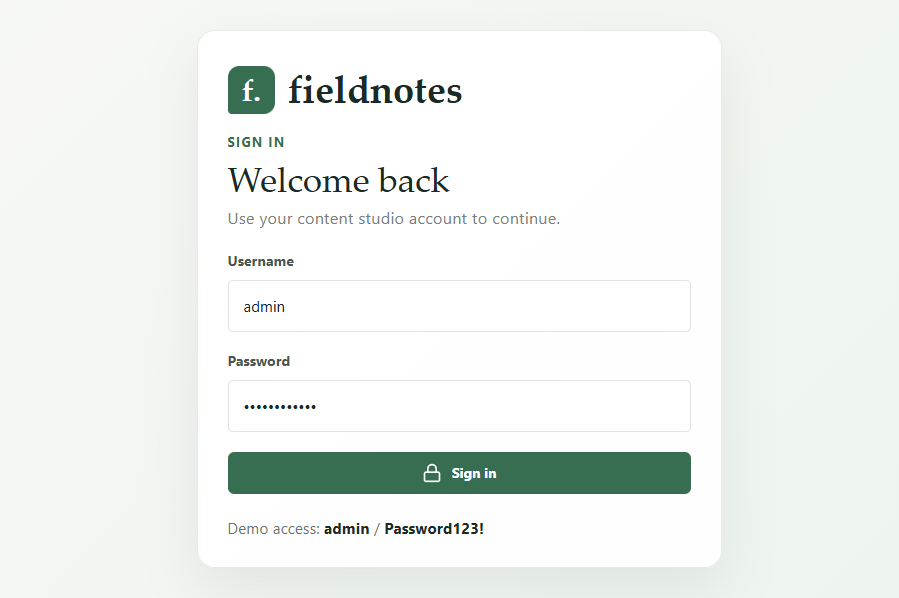
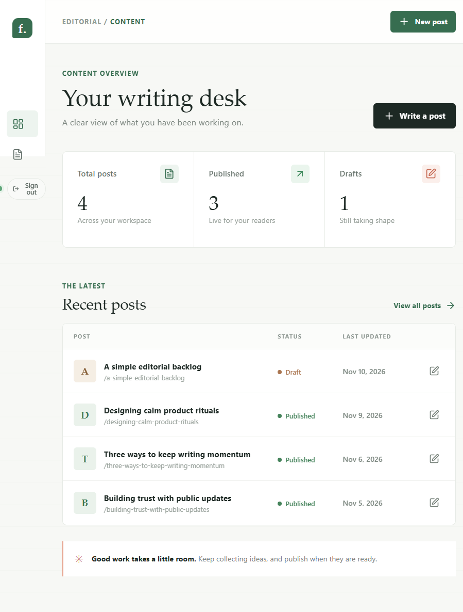
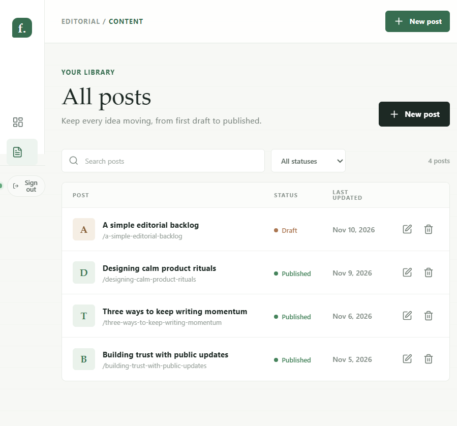

# Fieldnotes User Guide

Fieldnotes is a private workspace for drafting and managing blog posts. This guide uses the sample content included with a fresh database.

## Sign in

Start the app using the Docker Compose or local instructions in the [README](../README.md), then open [http://localhost:5173](http://localhost:5173).

Use the local demo account:

- Username: `admin`
- Password: `Password123!`

These are development credentials, not suitable for a public deployment. Configure your own credentials and a strong JWT signing key before exposing the app.

## Overview

After signing in, the overview summarizes all posts, published posts, and drafts. The recent-posts table links directly to an item for editing. Choose **New post** or **Write a post** to start a story, or choose **All posts** in the sidebar to browse the library.

A fresh database is populated with four sample posts: three published posts and one draft. Sample posts are inserted only when the database contains no posts. Existing content is left untouched.

## Manage posts

The **All posts** page lists every post and its status. Search by text, filter by **Published** or **Draft**, edit an item using its title or edit control, or delete it. Deletion asks for confirmation and cannot be undone.

To create a post, choose **New post** and enter a title and story. Excerpt and featured image URL are optional. Set the status to **Draft** to keep working privately or **Published** to publish it, then choose **Create post**. When editing an existing post, choose **Save changes** to apply updates.

## Sign out

Choose **Sign out** in the sidebar to end the current session. Protected pages and post API requests require signing in again after the token expires or is cleared.